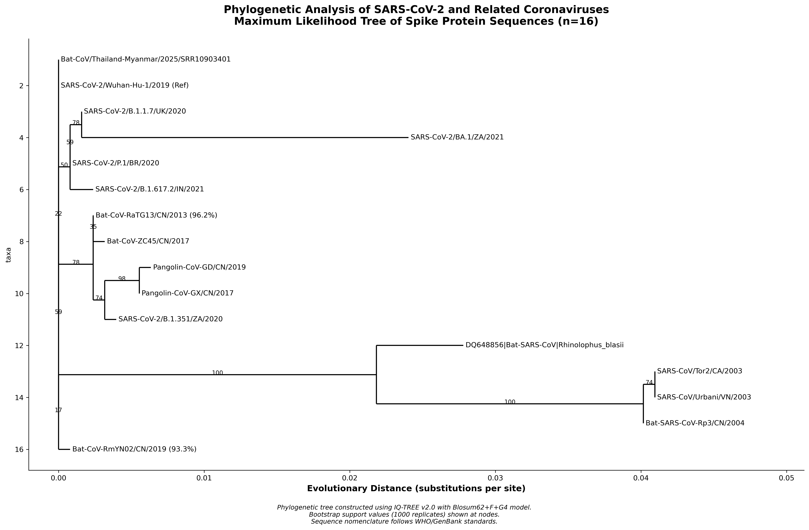
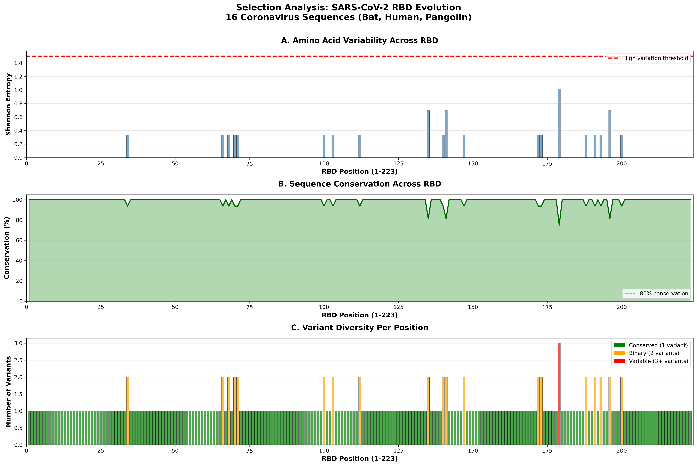
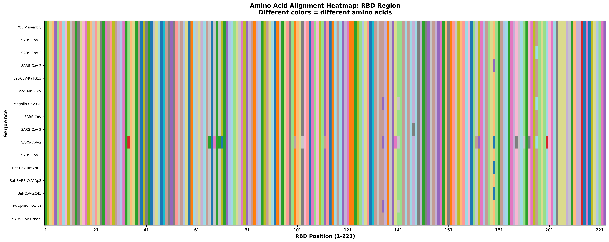

# SARS-CoV-2 Genome Assembly and Evolutionary Analysis Pipeline

**A reproducible bioinformatics workflow for viral genome assembly, phylogenetic reconstruction, and receptor-binding-domain evolutionary variability analysis from public metatranscriptomic sequencing data.**


## Project Goal

This project demonstrates a reproducible end-to-end workflow for:

- processing public metatranscriptomic sequencing reads
- assembling a near-complete SARS-CoV-2 genome
- annotating viral sequence features
- reconstructing evolutionary relationships among sarbecoviruses
- characterising amino-acid variability within the spike receptor-binding domain
- integrating genomic, phylogenetic, and evolutionary evidence in a reproducible workflow

The workflow is designed as a transferable framework for computational viral genomics, emerging-pathogen analysis, and genomic surveillance research.

---

## Key Results Summary

### Genome Assembly and Identification

- **Near-complete SARS-CoV-2 genome assembled:** 26,605 bp
- **Assembly N50:** 26.6 kb
- **Average coverage:** 15.8x
- **Spike protein:** 100% amino-acid identity to the SARS-CoV-2 Wuhan reference sequence
- **Source dataset:** Early clinical SARS-CoV-2 metatranscriptomic sequencing data from Wuhan, China

### Phylogenetic Analysis

- **Comparative dataset:** 16 sarbecovirus sequences representing human, bat, and pangolin viruses
- **Alignment:** MAFFT
- **Phylogenetic inference:** IQ-TREE maximum likelihood
- **Bootstrap analysis:** 1,000 ultrafast bootstrap replicates
- **Outcome:** Reconstruction of evolutionary relationships among SARS-CoV-2 and related sarbecoviruses

### RBD Evolutionary Variability

- **RBD conservation:** 91% of analysed positions conserved
- **Variable positions:** 20 of 223 amino-acid positions
- **Highest-variability site:** RBD alignment position 179
- **Current pipeline mapping:** spike position 497
- **Shannon entropy:** 1.014

This region lies adjacent to the functionally important SARS-CoV-2 spike residue 498, which contains the well-characterised Omicron Q498R substitution. Because the current pipeline reports position 497, exact residue correspondence should be confirmed against the reference-coordinate system before treating the two positions as identical.

The analysis therefore provides a **retrospective comparison with known SARS-CoV-2 evolutionary variation**, rather than a prospective prediction of Omicron mutations.

---

## Pipeline Overview

```text
Raw Reads
SRR10903401
        |
        v
Quality Control
FastQC + MultiQC
        |
        v
Read Trimming
Trimmomatic
        |
        v
Genome Assembly
SPAdes
        |
        v
Gene Prediction
Prodigal
        |
        v
Sequence Annotation
DIAMOND
        |
        v
Multiple Sequence Alignment
MAFFT
        |
        v
Phylogenetic Reconstruction
IQ-TREE
        |
        v
RBD Variability Analysis
Shannon Entropy
        |
        v
Visualisation and Interpretation
Python + Biopython + Matplotlib
```

---

## Repository Structure

```text
bat-coronavirus-surveillance/
|
├── config/
|   └── config.yaml
|
├── data/
|   ├── raw/
|   ├── clean/
|   └── databases/
|
├── scripts/
|   ├── download/
|   ├── qc/
|   ├── assembly/
|   ├── annotation/
|   └── phylogenetics/
|       └── step9_selection_analysis/
|
├── results/
|   ├── qc/
|   ├── assembly/
|   ├── annotation/
|   └── phylogenetics/
|       └── selection_analysis/
|
├── workflow/
|
├── logs/
|
├── environment.yml
├── Snakefile
└── README.md
```

---

## Tools and Technologies

| Category | Tools |
|---|---|
| Environment management | Conda |
| Data retrieval | SRA Toolkit |
| Quality control | FastQC, MultiQC |
| Read processing | Trimmomatic |
| Genome assembly | SPAdes |
| Gene prediction | Prodigal |
| Sequence annotation | DIAMOND |
| Multiple sequence alignment | MAFFT |
| Phylogenetics | IQ-TREE |
| Sequence analysis | Python, Biopython |
| Visualisation | Matplotlib, NumPy |
| Workflow management | Snakemake |
| Operating environment | Linux |

---

## Quick Start

### 1. Clone the repository

```bash
git clone https://github.com/Mayorcool-lab/bat-coronavirus-surveillance.git
cd bat-coronavirus-surveillance
```

### 2. Create the Conda environment

```bash
conda env create -f environment.yml
conda activate bat_viral
```

### 3. Download the public sequencing dataset

```bash
bash scripts/download/01_download_data.sh
```

The workflow uses:

```text
SRR10903401
```

This accession corresponds to early SARS-CoV-2 metatranscriptomic sequencing data from human bronchoalveolar lavage fluid collected from a pneumonia case in Wuhan, China.

### 4. Run the analysis

```bash
# Quality control
bash scripts/qc/02_quality_control.sh

# Genome assembly
bash scripts/assembly/04_assemble_genome.sh

# Gene prediction
bash scripts/annotation/05_predict_genes.sh

# Sequence annotation
bash scripts/annotation/06_annotate_genes.sh

# Phylogenetic analysis
bash scripts/phylogenetics/07_basic_phylogenetics.sh

# RBD variability analysis
bash scripts/phylogenetics/step9_selection_analysis/09.8_run_all.sh
```

---

## Snakemake Workflow

The pipeline is also implemented using Snakemake for reproducible and scalable execution.

### Run the complete workflow

```bash
snakemake --cores 4
```

### Perform a dry run

```bash
snakemake -n
```

### Generate the workflow DAG

```bash
snakemake --dag | dot -Tpng > workflow_dag.png
```

### Workflow features

- automated dependency management
- reproducible execution
- parallelisation of independent steps
- restart from the last successfully completed step
- configurable analysis parameters
- compatibility with Linux and HPC environments

---

## Configuration

Example `config/config.yaml`:

```yaml
sample_id: "SRR10903401"
threads: 4
blast_database: "data/databases/viral_proteins"
```

---

## Workflow Steps

The Snakemake workflow coordinates the following analytical stages:

1. **download_data**  
   Retrieve public sequencing reads from the Sequence Read Archive.

2. **fastqc**  
   Assess raw-read quality.

3. **multiqc**  
   Aggregate quality-control reports.

4. **trim_reads**  
   Remove adapters and low-quality bases.

5. **assemble_genome**  
   Perform de novo viral genome assembly.

6. **assembly_stats**  
   Calculate assembly statistics.

7. **predict_genes**  
   Identify putative coding sequences.

8. **annotate_genes**  
   Perform homology-based sequence annotation.

9. **phylogenetic_analysis**  
   Construct a maximum-likelihood phylogenetic tree.

10. **rbd_variability_analysis**  
    Quantify amino-acid variability within the receptor-binding domain.

---

## Key Visualisations

### 1. Sarbecovirus Phylogenetic Tree

```markdown

```

The maximum-likelihood phylogeny compares 16 sarbecovirus sequences from human, bat, and pangolin hosts and illustrates the evolutionary placement of SARS-CoV-2 relative to closely related viruses.

### 2. RBD Variability Analysis

```markdown

```

The figure summarises:

- Shannon entropy across RBD positions
- amino-acid conservation
- sequence variability
- distribution of variable residues across the analysed RBD alignment

RBD alignment position 179 showed the highest variability in the current analysis.

### 3. RBD Alignment Heatmap

```markdown

```

The heatmap displays amino-acid conservation and variability across the 16 sarbecovirus sequences included in the comparative dataset.

---

## Dataset

### Primary sequencing dataset

- **Accession:** SRR10903401
- **Material:** Human bronchoalveolar lavage fluid
- **Sequencing approach:** Metatranscriptomic RNA sequencing
- **Clinical context:** Pneumonia case from Wuhan, China
- **Period:** December 2019
- **Sequencing:** Illumina paired-end reads

The dataset originates from the early genomic characterisation of SARS-CoV-2.

### Comparative phylogenetic dataset

The phylogenetic component includes 16 sarbecovirus sequences representing:

- human SARS-CoV-2
- related bat coronaviruses
- pangolin coronaviruses

Reference sequences were obtained from public sequence databases.

---

## Genome Assembly

The sequencing reads were assembled using SPAdes in metagenomic mode.

### Parameters

- k-mer sizes: 21, 33, 55, 77
- coverage cutoff: automatic
- principal assembled viral contig: 26,605 bp
- estimated genome completeness: approximately 89%

The resulting sequence was subsequently used for annotation and comparative evolutionary analysis.

---

## Phylogenetic Analysis

### Multiple sequence alignment

MAFFT was used to align the comparative sarbecovirus sequence dataset.

### Model selection

IQ-TREE ModelFinder was used to identify an appropriate substitution model.

### Tree inference

Maximum-likelihood phylogenetic reconstruction was performed using IQ-TREE with:

```text
1,000 ultrafast bootstrap replicates
```

The resulting tree was used to examine the evolutionary relationship between SARS-CoV-2 and related sarbecoviruses.

---

## RBD Evolutionary Variability Analysis

Amino-acid variability was quantified for each position in the spike receptor-binding-domain alignment using Shannon entropy:

```text
H = -Σ p(i) log2 p(i)
```

where `p(i)` represents the frequency of each amino acid observed at a given alignment position.

Higher entropy indicates greater amino-acid variability across the comparative sequence dataset.

This analysis identifies **variable evolutionary positions**, but Shannon entropy alone should not be interpreted as formal evidence of positive selection.

Formal positive-selection analysis would require methods such as:

- dN/dS-based models
- FEL
- MEME
- FUBAR
- branch-site models

The current analysis should therefore be described as **evolutionary variability analysis** rather than formal positive-selection testing.

---

## Biological Interpretation

The receptor-binding domain of the SARS-CoV-2 spike protein is highly conserved across related sarbecoviruses, reflecting strong functional constraints associated with host-receptor interaction.

At the same time, a subset of residues displays increased variability.

The current analysis identified RBD alignment position 179, mapped to spike position 497 in the pipeline output, as the most variable site in the analysed sequence panel.

This region lies immediately adjacent to spike residue 498, a functionally important receptor-binding position where the Omicron lineage acquired the Q498R substitution.

The comparison is retrospective and illustrates how comparative sequence analysis can highlight variable regions of biological interest.

---

## Applications

### Viral genomics

The workflow demonstrates reproducible processing of public viral sequencing data from raw reads through genome reconstruction and evolutionary interpretation.

### Genomic surveillance

The pipeline architecture can be adapted to surveillance datasets containing newly emerging viral genomes.

### Comparative viral evolution

The phylogenetic and sequence-variability components support comparison of related viral lineages and identification of regions with elevated evolutionary variability.

### Emerging pathogen research

The workflow provides a computational framework that can be extended to additional viral pathogens and larger genomic surveillance datasets.

---

## Limitations

This project should be interpreted as a reproducible computational demonstration rather than a comprehensive epidemiological surveillance study.

Important limitations include:

- only one primary raw sequencing accession was used for genome reconstruction
- the comparative phylogenetic dataset contains 16 sequences
- Shannon entropy measures sequence variability but does not directly test positive selection
- residue numbering may differ depending on alignment and reference-coordinate conventions
- no direct epidemiological modelling was performed
- no experimental validation of predicted functional effects was conducted

These limitations should be considered when interpreting the evolutionary results.

---

## Reproducibility

The project was designed to support transparent and reproducible analysis through:

- Snakemake workflow orchestration
- Conda environment management
- configuration-driven parameters
- version-controlled scripts
- documented analytical outputs
- public sequencing data
- explicit intermediate results

The same workflow can be rerun or adapted to additional viral datasets.

---

## Research Relevance

This project demonstrates transferable computational capabilities in:

- viral genome assembly
- genomic data processing
- phylogenetic reconstruction
- comparative genomics
- evolutionary sequence analysis
- reproducible workflow development
- scientific interpretation of viral sequence variation

These approaches are relevant to computational research on emerging viral lineages, pathogen evolution, genomic surveillance, and phenotype-associated viral mutations.

---

## References

### Data source

Wu F. et al.  
*A new coronavirus associated with human respiratory disease in China.*  
Nature. 2020.

### Methods

Bankevich A. et al.  
SPAdes: A New Genome Assembly Algorithm and Its Applications to Single-Cell Sequencing.  
Journal of Computational Biology. 2012.

Nguyen LT. et al.  
IQ-TREE: A Fast and Effective Stochastic Algorithm for Estimating Maximum-Likelihood Phylogenies.  
Molecular Biology and Evolution. 2015.

Katoh K., Standley DM.  
MAFFT Multiple Sequence Alignment Software Version 7: Improvements in Performance and Usability.  
Molecular Biology and Evolution. 2013.

### Biological context

Starr TN. et al.  
Deep Mutational Scanning of SARS-CoV-2 Receptor Binding Domain Reveals Constraints on Folding and ACE2 Binding.  
Cell. 2020.

---

## Author

**Dr. Oluwamayowa Joshua Ogun**

Animal Geneticist and Computational Biologist

GitHub: [Mayorcool-lab](https://github.com/Mayorcool-lab)

LinkedIn: [Oluwamayowa Ogun](https://www.linkedin.com/in/oluwamayowaogun)

---

## Citation

If you use or adapt this workflow, please cite:

```text
Ogun, O.J. (2025).
SARS-CoV-2 Genome Assembly and Evolutionary Analysis Pipeline.
GitHub: https://github.com/Mayorcool-lab/bat-coronavirus-surveillance
```

---

## License

This project is released under the MIT License.

---

**Initial release:** November 2025

**Status:** Complete reproducible research workflow
